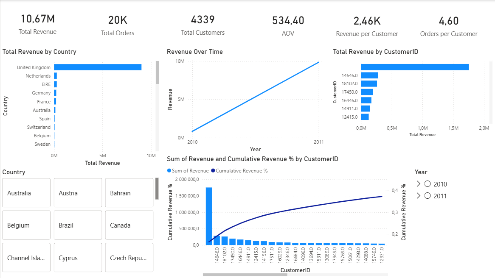
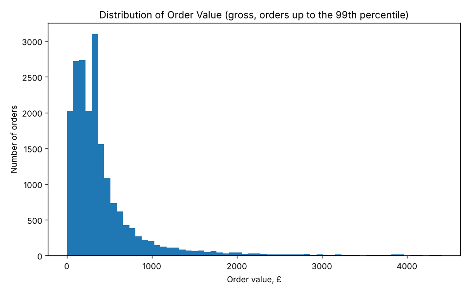
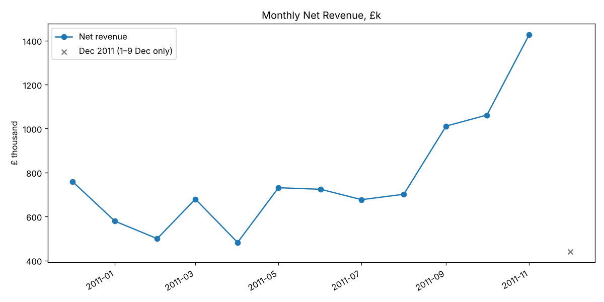

# Business Performance Analytics

## Project Overview
This project analyzes transactional data from an online retail company to assess business performance, customer
concentration, and revenue dynamics over time.

The objective is to demonstrate an end-to-end analytics workflow:
raw transactional data → data quality checks → cleaning → KPI calculation → business insights → SQL validation → interactive dashboard.

A large part of the project is about **getting revenue right**: duplicates, service charges and cancelled orders
change the top-customer list and the concentration metrics, so every cleaning rule is documented and every KPI is
cross-checked in SQL.


## Data Source

Raw and processed datasets are not included in the repository due to file size limitations.
They are available here:
https://drive.google.com/drive/folders/1-OxCxu3kUkfWN-SOgmVQpraj2LWJzxjQ?usp=drive_link

Place `online_retail.xlsx` into `data/raw/` before running the notebook.

Source:
- Online Retail Dataset (UCI Machine Learning Repository)
  https://archive.ics.uci.edu/ml/datasets/online+retail


## Dataset
- **Source:** Online Retail transactional dataset (UK-based online retailer, mostly wholesale customers)
- **Time period:** 1 December 2010 – 9 December 2011 (**December 2011 is a partial month**)
- **Size:** 541,909 transaction rows
- **Granularity:** line items (invoice × product)
- **Fields:** invoice number, stock code, description, quantity, invoice date, unit price, customer ID, country

All analysis steps are fully reproducible with the provided notebook.


## Tools & Technologies
- **Python:** pandas, numpy, matplotlib
- **SQL:** SQLite (KPI recalculation and validation against pandas)
- **Power BI:** interactive dashboards, DAX measures, slicers
- **GitHub:** project structuring and version control


## Analysis Scope
The analysis covers:
- Data quality checks (duplicates, cancellations, zero or negative values, missing customer IDs, non-product codes)
- Cleaning rules and **net revenue** calculation (sales minus cancellations)
- Order-level aggregation and order value distribution
- Revenue-based KPIs and business metrics
- Customer concentration and Pareto (80/20) analysis
- Monthly revenue trends, with the partial last month handled separately
- Cross-validation of all results using SQL queries


## Data Cleaning

| Issue found | Rows | Treatment |
|---|---:|---|
| Exact duplicate rows | 5,268 | removed |
| Service codes (postage, manual adjustments, Amazon fees, bad debt, samples, bank charges…) | ~2,900 | excluded — not product revenue |
| Zero or negative unit price | 2,517 | excluded |
| Cancellations (`InvoiceNo` starting with `C`) | 9,288 | **kept as negative revenue** → net revenue |
| Missing `CustomerID` | 135,080 | kept for totals, excluded from customer-level analysis |

**Why cancellations are netted instead of dropped.** Removing only the cancellation lines keeps the original orders
that were later cancelled. In this dataset two customers (16446 and 12346) each placed one huge order — 80,995 and
74,215 units — and cancelled it within minutes. Counted as gross sales, they would rank 4th and 9th among all
customers; after netting, their revenue is close to zero.


## Key Metrics

| KPI | Value |
|---|---:|
| Gross sales | £10.25M |
| Cancelled value | £0.48M (4.6% of gross sales) |
| **Net revenue** | **£9.77M** |
| Total orders (invoices) | 19,773 |
| Total customers (known ID) | 4,334 |
| Average order value | £518 |
| Median order value | £302 |
| Top-10 customers' share of net revenue | 16.6% |
| Customers generating 80% of net revenue | 27% |
| Sales without a customer ID | 14.7% of gross sales |


## Key Insights
- Revenue is highly concentrated: **27% of customers generate 80% of net revenue**, and the top 10 customers alone
  bring 16.6%. This exposes the business to customer concentration risk.

- Order value distribution is strongly right-skewed: the average order (£518) is far above the median (£302) because
  of a long tail of large wholesale orders. Revenue growth depends on order size as much as on order count.

- Revenue grows strongly toward the end of the year: September–November 2011 averaged **+84%** compared with
  January–August, with a peak of £1.43M in November 2011.

- December 2011 is **not a decline**: the data ends on 9 December. Revenue per trading day in December is in line with
  November. With 12 full months of data this is one year-end peak; confirming it as seasonality would require more history.

- Data quality changes the answer: duplicates, service codes and cancelled mega-orders change both the top-customer
  list and the concentration metrics, so cleaning rules must be explicit and validated.

- About 15% of sales have no customer ID, which limits customer-level analysis (retention, segmentation) for that share.


## Power BI Dashboard
An interactive Power BI dashboard was developed to visualize key business insights, including:
- Total revenue by country
- Revenue trends over time
- Top customers by revenue
- Cumulative revenue share (Pareto curve)
- KPI summary cards with interactive filters (country, year, quarter)

The interactive Power BI dashboard is available in this repository:

`/powerbi/business_dashboard.pbix`

Due to GitHub limitations, the file cannot be previewed online.
To view the dashboard, please download the `.pbix` file and open it in Power BI Desktop.

> The dashboard was built on an earlier version of the cleaned data (gross sales). To match the notebook figures,
> refresh it from `data/processed/transactions_clean.csv`, which the current notebook produces.

### Dashboard Preview



### Customer Revenue Concentration (Pareto Analysis)


The chart shows the cumulative share of net revenue as customers are added from the largest to the smallest.
The curve crosses 80% at about 27% of customers (dotted line): a relatively small group of high-value customers
generates most of the revenue, while the long tail of small customers adds little individually.

### Distribution of Order Revenue



Most orders are between £150 and £500 (interquartile range £152–£481), but a small number of very large orders pull
the average well above the median. The chart shows orders up to the 99th percentile (£4,409); the largest orders go far beyond it.

### Monthly Revenue Over Time



Net revenue fluctuates between £0.48M and £0.76M per month in the first part of the year and rises sharply from
September, peaking at £1.43M in November 2011. The grey cross marks December 2011, which covers only 1–9 December
and is therefore not comparable with full months.


## The notebook includes
[`notebooks/01_business_analysis.ipynb`](notebooks/01_business_analysis.ipynb)
- Data quality checks
- Data cleaning logic and net revenue calculation
- Feature engineering (order-level and monthly aggregates)
- KPI computation
- Customer concentration and Pareto analysis
- Exploratory charts
- SQL-based validation: KPIs, top customers and monthly revenue are recomputed in SQLite and asserted equal to the pandas results


## Business Interpretation

- The strong revenue concentration means that losing a small group of high-value customers could cause a
  disproportionate revenue decline. This calls for focused retention, loyalty programs and proactive account
  management for the top tier.

- The right-skewed order value suggests that upselling, bundles and volume pricing for existing customers may have a
  larger impact on revenue than efforts aimed only at increasing the number of transactions.

- The year-end peak implies that inventory, marketing budgets and operational capacity should be planned ahead of
  September–November to avoid missed revenue or supply constraints.

- Customers with low individual revenue but frequent purchases represent a growth segment if nudged toward
  larger orders through personalized offers or bundles.

- Cancellations remove about 5% of gross sales and are concentrated in a few very large orders; reporting gross sales
  without netting them overstates both revenue and the importance of specific customers.

- Capturing a customer ID for the ~15% of anonymous sales would make retention and segmentation analysis more complete.


## How to Run

```bash
pip install -r requirements.txt
# put online_retail.xlsx into data/raw/
jupyter notebook notebooks/01_business_analysis.ipynb
```


## Author
**Konstantin Rudnev**
Business & Product Analyst
Open to opportunities across Europe

[LinkedIn](https://www.linkedin.com/in/konstantin-rudnev-a96727354) · GitHub: https://github.com/Konstantin667

## License
This project is licensed under the MIT License.
