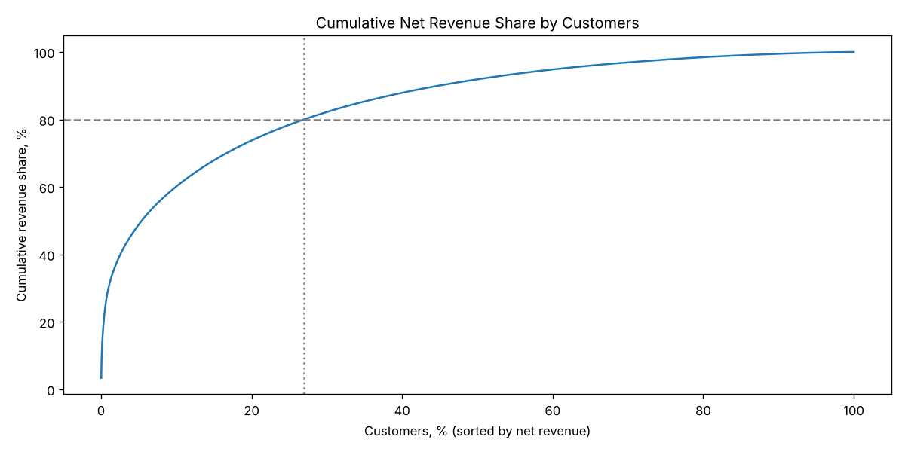

# Business Performance Analytics

Analysis of an online retailer's transactions to assess revenue, customer concentration and revenue dynamics:
raw transactional data → data quality checks → cleaning → KPIs → business insights → SQL validation → Power BI dashboard.

## Data

- **Source:** [Online Retail dataset, UCI Machine Learning Repository](https://archive.ics.uci.edu/ml/datasets/online+retail)
- **Period:** 1 December 2010 – 9 December 2011 (December 2011 is a partial month)
- **Size:** 541,909 line items, UK-based retailer with mostly wholesale customers
- Raw and processed files are not stored in the repo. Download `online_retail.xlsx` from UCI or from
  [Google Drive](https://drive.google.com/drive/folders/1-OxCxu3kUkfWN-SOgmVQpraj2LWJzxjQ?usp=drive_link)
  and place it in `data/raw/`.

## Tools

- **Python:** pandas, numpy, matplotlib
- **SQL:** SQLite — every KPI is recomputed in SQL and asserted equal to the pandas result
- **Power BI:** interactive dashboard, DAX measures, slicers

## Data cleaning

| Issue found | Rows | Treatment |
|---|---:|---|
| Exact duplicate rows | 5,268 | removed |
| Service codes (postage, manual adjustments, Amazon fees, bad debt, samples…) | ~2,900 | excluded — not product revenue |
| Zero or negative unit price | 2,517 | excluded |
| Cancellations (`InvoiceNo` starting with `C`) | 9,288 | **kept as negative revenue** → net revenue |
| Missing `CustomerID` | 135,080 | kept for totals, excluded from customer-level analysis |

Why cancellations are netted instead of dropped: removing only the cancellation lines keeps the original orders
that were later cancelled. In this dataset, two "top-10 customers" (16446 and 12346) each placed one huge order
(80,995 and 74,215 units) and cancelled it within minutes. Counting gross sales would put them among the largest clients.

## Key metrics

| KPI | Value |
|---|---:|
| Gross sales | £10.25M |
| Cancelled value | £0.48M (4.6%) |
| **Net revenue** | **£9.77M** |
| Orders (invoices) | 19,773 |
| Customers with a known ID | 4,334 |
| Average / median order value | £518 / £302 |
| Top-10 customers' share of net revenue | 16.6% |
| Customers generating 80% of net revenue | 27% |

## Key insights

- **Customer concentration:** 27% of customers generate 80% of net revenue, and the top 10 bring 16.6%.
  Losing a few key accounts would hit revenue hard → focused retention and account management for the top tier.
- **Right-skewed order values:** the mean order (£518) is far above the median (£302) because of large wholesale
  orders. Growth levers are order size (upsell, bundles, volume pricing) as much as order count.
- **Strong year-end growth:** September–November 2011 average +84% vs January–August, peaking in November (£1.43M).
  December 2011 looks like a drop only because the data stops on 9 December; revenue per trading day is in line with November.
  With 12 full months this is one year-end peak — confirming seasonality would need more than one year of data.
- **Data quality changes the answer:** duplicates, service codes and cancelled mega-orders change the top-customer
  list and the concentration metrics. Cleaning rules are documented and validated in SQL.

## Charts

### Monthly net revenue


### Customer revenue concentration (Pareto)


### Order value distribution


## Power BI dashboard

`powerbi/business_dashboard.pbix` — revenue by country, revenue over time, top customers, Pareto curve and KPI cards
with country / year / quarter filters. Download the file and open it in Power BI Desktop (GitHub cannot preview `.pbix`).


> The dashboard was built on an earlier version of the cleaned data (gross sales). To match the notebook,
> refresh it from `data/processed/transactions_clean.csv` produced by the current notebook.

## Repository structure

```
notebooks/01_business_analysis.ipynb   cleaning, KPIs, concentration, time trends, SQL validation
assets/                                charts used in this README
powerbi/                               dashboard (.pbix) and preview
data/raw, data/processed               local data folders (not tracked)
```

## How to run

```bash
pip install -r requirements.txt
# put online_retail.xlsx into data/raw/
jupyter notebook notebooks/01_business_analysis.ipynb
```

## Author

**Konstantin Rudnev** — Business & Product Analyst
[LinkedIn](https://www.linkedin.com/in/konstantin-rudnev-a96727354) · [GitHub](https://github.com/Konstantin667)

## License

MIT
